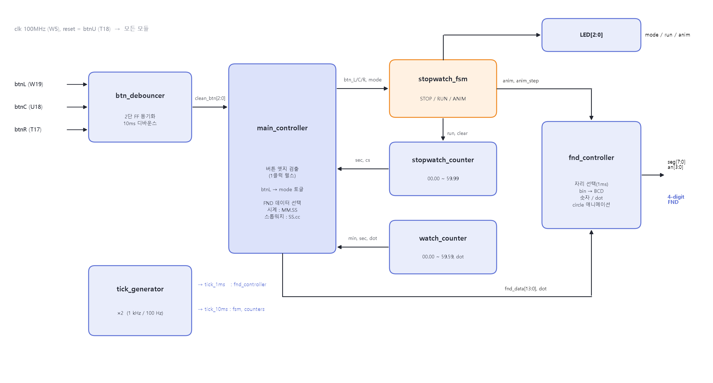
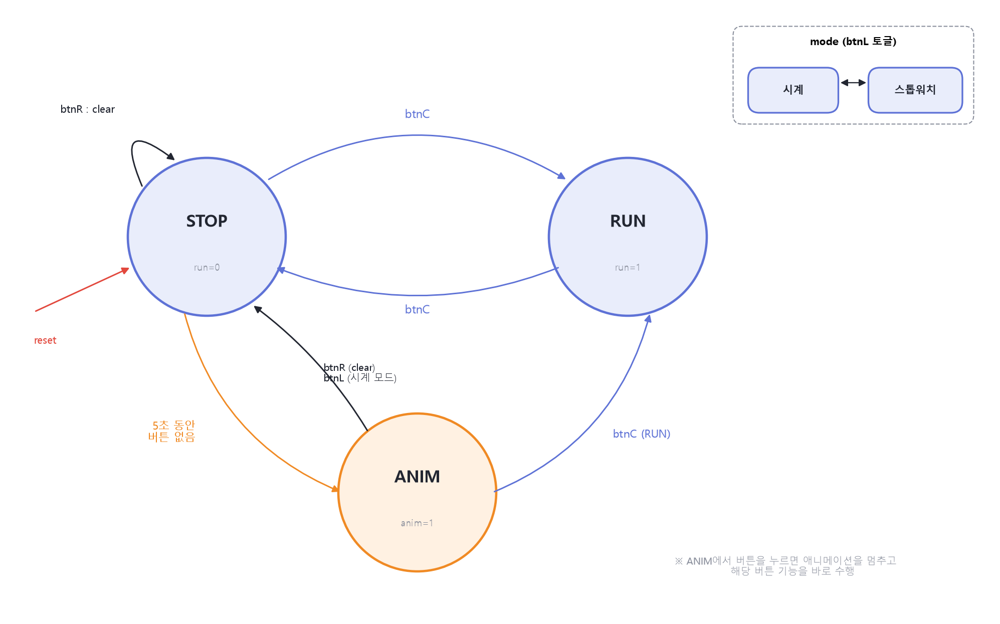
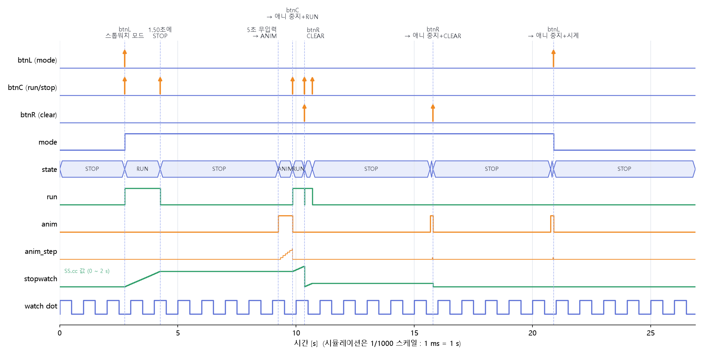

# 분초시계 & Stopwatch (Basys3)

Basys3(xc7a35tcpg236-1) 4자리 FND에 분초시계와 스톱워치를 구현한 Verilog 프로젝트 (Vivado 2020.2)

## 기능
- **분초시계 (MM.SS)** : 리셋 후 바로 동작, 분과 초 사이 Dot가 1초에 1번 깜박 (0.5초 ON / 0.5초 OFF)
- **스톱워치 (SS.cc)** : 1/100초 단위 RUN / STOP / CLEAR
- **circle 애니메이션** : 스톱워치 일시정지 상태에서 5초 동안 입력이 없으면 FND 테두리 회전,
  버튼을 누르면 애니메이션을 멈추고 해당 버튼 기능을 바로 수행

## 버튼 / LED
| 입력 | 기능 |
|---|---|
| btnL (W19) | 모드 전환 : 시계 ↔ 스톱워치 |
| btnC (U18) | 스톱워치 RUN / STOP |
| btnR (T17) | 스톱워치 CLEAR (STOP 상태) |
| btnU (T18) | reset |
| LED0 / 1 / 2 | mode / run / anim |

## 구조
```
src/
  top.v                 최상위
  btn_debounce10ms.v    2단 FF 동기화 + 10ms 디바운스   [09번 재사용, 파라미터 추가]
  tick_generator.v      1 kHz / 100 Hz tick              [09번 그대로]
  main_controller.v     버튼 엣지 검출, 모드 전환, FND 데이터 선택   [신규]
  stopwatch_fsm.v       STOP / RUN / ANIM FSM            [신규]
  stopwatch_counter.v   00.00 ~ 59.99                    [신규]
  watch_counter.v       00.00 ~ 59.59, dot               [신규]
  fnd_controller.v      자리 스캔, BCD, dot, 애니메이션  [09번 재사용, dot/애니 추가]
  tb_top.v              테스트벤치 (1초 = 시뮬레이션 1ms)
  basys3_stopwatch.xdc
```
코드 안의 `[원본] / [수정] / [추가] / [신규]` 주석으로 기존 코드에서 바뀐 부분을 표시했습니다.

## 원본 비교용 폴더
`reference/09.up_down_counter/` : 재사용한 09번 up/down counter 프로젝트 **원본 그대로** (수정 없음).
파일 대응표는 [reference/09.up_down_counter/README.md](reference/09.up_down_counter/README.md) 참고.

## 실행
- 프로젝트 열기 : `11.stopwatch.xpr`
- 프로젝트 새로 만들기 + 비트스트림 : `vivado -mode batch -source create_project.tcl`
- 바로 보드에 올리기 : `bitstream/top.bit`

## 결과
- 시뮬레이션 : 16개 check 모두 ok → `PASS stopwatch`
- 합성/구현 : LUT 315, FF 167, WNS +5.141 ns, WHS +0.199 ns, Warning 0 (`reports/`)




